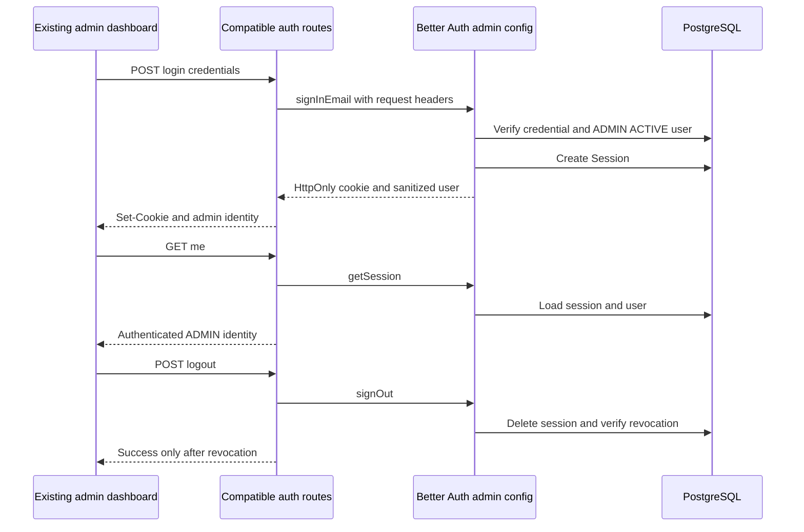
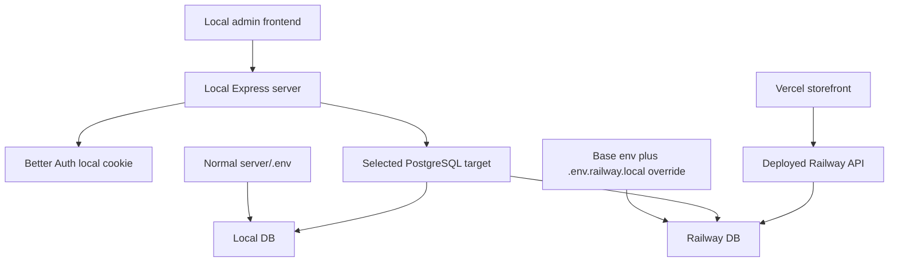

# Auth Architecture And Roadmap

Last updated: 2026-10-11

## Current Authentication

Customer and admin authentication both use Better Auth, with separate configurations and cookie prefixes. The user explicitly authorized the admin migration during the production audit. The existing dashboard and customer UX remain intact. No new database models or migrations were required.

| Surface | Native base path | Client transport | Database authority |
| --- | --- | --- | --- |
| Customer | `/api/customer-auth` | Existing account auth API and Better Auth Vue client | User, Account, Session, Verification |
| Admin | `/api/admin-auth` | Compatible `/api/auth/login`, `/logout`, `/me`, `/data-target` | Existing User/Account/Session, ADMIN and ACTIVE |

The admin configuration is not the Better Auth admin plugin. It uses the Prisma adapter, native credential/session API, disabled public signup, a session-creation role/status gate and a fresh server-side role/status check on every protected request. Only sign-in/email, sign-out and get-session native admin paths are mounted. No bearer fallback exists.

## Admin Login And Revocation

`adminAuth.service.js` owns the engine; `auth.service.js` delegates compatibility requests and forwards native cookies. `requireAdminAuth.js` checks database-backed session, ADMIN role and ACTIVE status. The Vue login helper confirms `/api/auth/me` before redirecting to a constrained admin-only return path.

Admin cookies use a separate `doggy-admin` prefix, path /, no Domain attribute, HttpOnly and an absolute eight-hour session lifetime with refresh/cache disabled. Local HTTP uses SameSite=Lax; production uses Secure and SameSite=None for the current split-host deployment. Legacy signed admin cookies are not accepted and login/logout clears the old cookie. Database deletion failure returns an error rather than falsely claiming logout; the client retains an error/retry state.

Better Auth does not eliminate Safari third-party cookie restrictions. An owned storefront domain plus same-site API subdomain is still the recommended deployed arrangement. CORS accepts only exact configured origins. Production no longer implicitly trusts localhost; list it explicitly only if deliberately needed.

## Deliberate Admin Provisioning

`server/scripts/provision-admin.js` uses existing environment variables and the admin provisioning service/repository. It never runs on startup. The audit provisioned only the confirmed loopback local DB.

1. Confirm database identity and backup before any shared-database change.
2. Verify migrations separately; provisioning requires existing Better Auth tables.
3. Run `cd server && npm run admin:provision` for a read-only preflight.
4. After confirming LOCAL target, run `npm run admin:provision -- --apply`.
5. Re-run preflight to confirm idempotence, then sign in through the existing admin login page.

The script refuses remote hosts by default. `--allow-remote` is an explicit safety override, not permission to use Railway: it is reserved for a separately approved, target-confirmed rollout. Default script loading uses normal server/.env; any shared rollout must supply the reviewed target explicitly rather than assuming that an unrelated running dev:railway server changes CLI configuration.

Provisioning imports the existing ADMIN_PASSWORD_HASH only when creating a new ADMIN credential. It refuses an email already held by a CUSTOMER, does not promote users and does not overwrite existing admin passwords. Imported bcrypt hashes remain verifiable only in the dedicated admin configuration; newly generated hashes use Better Auth scrypt. Changing environment credentials afterward does not rotate a provisioned database credential. Account recovery, credential rotation UI and MFA are future approved work.

## Customer Sessions And Ownership

The customer configuration and Vue APIs remain on /api/customer-auth. Public role/status fields have input:false, so signup stays CUSTOMER/ACTIVE. Customer route guards use requireCustomerAuth; inactive users are rejected. Guest checkout remains available. Order.userId is derived from the server-side session, never a browser user ID.

Customer order queries scope linked rows to the authenticated ID. Older guest orders are matched only when the customer's email is verified, normalized and matches a guest row with userId null. Public signup still does not require verification before login, preserving UX; duplicate-email signup can reveal registration. Verified-email ownership must not be relaxed.

All JSON auth responses are sanitized for password/session/provider tokens, including list-sessions and change-password responses. HttpOnly transport cookies remain necessary and are never printed. Existing UI does not implement a token-based individual-device revocation screen; adding one must preserve the no-token-exposure policy. Customer logout also verifies DB revocation. Password-reset tokens are one-use with the engine's one-hour default expiry; reset revokes existing customer sessions. Memory-adapter tests exercise reuse, expiry and revocation, not live email delivery.

Customer lifecycle/profile hooks still write profile/preferences/events separately from auth signup; complete rollback/recovery on a hook failure is not certified. Do not claim account creation is a single application-wide transaction.
Admin-triggered verification/reset uses an absolute configured frontend return URL, not a relative backend route. Email builders share this validated frontend-origin helper; production startup rejects missing/insecure frontend configuration. Temporary local-to-Railway-DB security email should remain mocked unless public auth origin/signing compatibility and an approved inbox/budget are reviewed. Live delivery/return is not certified by a no-send callback fixture.

## Better Auth Infrastructure

The existing customer config uses `@better-auth/infra` and `dash({ apiKey: process.env.BETTER_AUTH_API_KEY })`. The Vue customer client uses dashClient(). The server key is not a Vite variable. The new admin config deliberately does not add a second Infrastructure integration.

Dashboard Base URL: the configured public backend origin represented by BETTER_AUTH_URL. Dashboard Base Path: /api/customer-auth. The endpoint structure is `<backend-origin>/api/customer-auth/get-session`; the actual Railway origin and dashboard connection are not inspected in this audit.

Installed Infra exposes dashboard management and event endpoints. Dashboard management requires provider-signed JWT/API-key binding, not a customer cookie. Event endpoints require session/user or organization permission checks in the installed package. This is a separate privileged provider surface, not public signup or a replacement for the application's ADMIN guard. No Infra admin grant, provider configuration, live connection, MFA or organizational schema was enabled. See the [API matrix](../audits/2026-10-11-api-access.md).

## Temporary Data Targets

- Fully local: server npm run dev:local; client npm run dev:local.
- Railway DB admin: server npm run dev:railway; client npm run dev:local.
- Both temporary browser modes call the local backend.
- LOCAL refuses remote database hosts. RAILWAY_DB requires a remote DATABASE_URL override. Production reports DEPLOYED rather than falsely reporting LOCAL.
- The badge waits for the authenticated backend response and displays TARGET UNVERIFIED on failure. A loopback tunnel cannot be distinguished from a local database by hostname alone; operator preflight is still necessary.

## Environment And Rollout

Variable names only; keep actual values in ignored env files or deployment dashboards:

| Location | Names and purpose |
| --- | --- |
| Server/Railway | DATABASE_URL; BETTER_AUTH_SECRET (preferred dedicated signing secret); BETTER_AUTH_URL (HTTPS backend origin in production); CLIENT_URL and/or FRONTEND_URL (comma-separated exact allowed origins); PORT; NODE_ENV |
| Provisioning only | ADMIN_EMAIL; ADMIN_PASSWORD_HASH (existing bcrypt hash with cost at least 10) |
| Compatibility | ADMIN_SESSION_SECRET signing fallback; API_BASE_URL backend-origin fallback |
| Existing Infrastructure/email | BETTER_AUTH_API_KEY; EMAIL_PROVIDER; RESEND_API_KEY; RESEND_FROM_EMAIL; RESEND_REPLY_TO_EMAIL |
| Vercel/client | VITE_API_BASE_URL, or VITE_API_URL compatibility alias; VITE_STRIPE_PUBLISHABLE_KEY; optional public display variables |

Production fails closed without a dedicated auth secret of at least 32 characters or HTTPS backend origin. BETTER_AUTH_URL must not include /api/customer-auth, /api/admin-auth, query or fragment: the installed engine preserves a configured URL path and would override the distinct basePath settings. The shared helper now rejects that configuration. The dev-only legacy hash fallback is not a production secret strategy.

Railway has not been provisioned, migrated or deployed in this audit. Before a separately authorized rollout, check Railway migration status/backup and existing admin-email conflicts, provision the reviewed target, deploy the matching server/client, and expect existing admin sessions to require sign-in again. server npm start runs prisma migrate deploy: it is not a harmless status command. No new auth migration is required, but unrelated pending migrations must still be reviewed.

Rollback must not restore the vulnerable signed-session code or publicly promote users. Keep the provisioned account inactive operationally until the corrected deployment is validated if rollout is delayed; any credential/session change requires owner approval.

## Verification And Next Work

Real engine tests cover admin/customer signup isolation, credential checking, expiry, token sanitization, logout/copied-cookie invalidation, DB-failure logout, password-reset reuse/expiry and session revocation. A guarded local Prisma/HTTP smoke check created and removed one admin test session, verified protected catalog access and logout, and rejected 20 anonymous routes.

Browser control was policy-blocked, so actual browser login/logout/relogin, desktop/mobile, Safari and deployed persistence remain manual QA. These results do not certify live Infra, email or payment providers.

Next: manual local admin acceptance; approved same-site deployment/provisioning; admin MFA and fine-grained permission design. Durable checkout recovery and atomic promo/campaign integrity remain launch blockers ahead of real-customer traffic. Future rewards, referrals and expanded roles must build on these sessions without rebuilding the dashboard.
