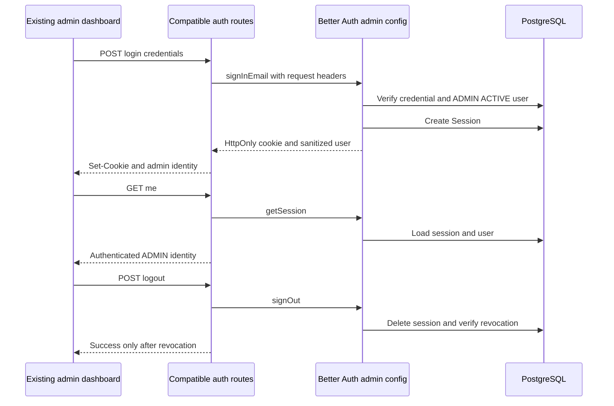
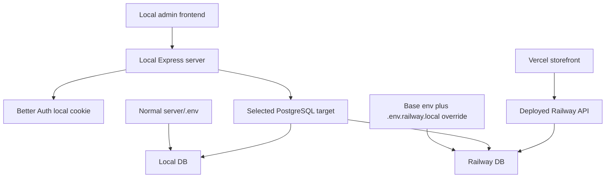

# Auth Architecture And Roadmap

Last updated: 2026-10-13

## Current Authentication

Customer and admin authentication both use Better Auth, with separate configurations and cookie prefixes. The user explicitly authorized the admin migration during the production audit. The existing dashboard and customer UX remain intact. No new database models or migrations were required.

| Surface | Native base path | Client transport | Database authority |
| --- | --- | --- | --- |
| Customer | `/api/customer-auth` | Existing account auth API and Better Auth Vue client | User, Account, Session, Verification |
| Admin | `/api/admin-auth` | Compatible `/api/auth/login`, `/logout`, `/me`, `/data-target` | Existing User/Account/Session, ADMIN and ACTIVE |

The admin configuration is not the Better Auth admin plugin. It uses the Prisma adapter, native credential/session API, disabled public signup, a session-creation role/status gate and a fresh server-side role/status check on every protected request. Only sign-in/email, sign-out and get-session native admin paths are mounted. No bearer fallback exists.

## Admin Login And Revocation

`adminAuth.service.js` owns the engine; `auth.service.js` delegates compatibility requests and forwards native cookies. `requireAdminAuth.js` checks database-backed session, ADMIN role and ACTIVE status. The Vue login helper confirms `/api/auth/me` before redirecting to a constrained admin-only return path.



Admin cookies use a separate `doggy-admin` prefix, path /, no Domain attribute, HttpOnly and an absolute eight-hour session lifetime with refresh/cache disabled. Local HTTP uses SameSite=Lax; production uses Secure and SameSite=None for the current split-host deployment. Legacy signed admin cookies are not accepted and login/logout clears the old cookie. Database deletion failure returns an error rather than falsely claiming logout; the client retains an error/retry state.

Better Auth does not eliminate Safari third-party cookie restrictions. An owned storefront domain plus same-site API subdomain is still the recommended deployed arrangement. CORS accepts only exact configured origins. Production no longer implicitly trusts localhost; list it explicitly only if deliberately needed.

## Deliberate Admin Provisioning

`server/scripts/provision-admin.js` uses existing environment variables and the admin provisioning service/repository. It never runs on startup. The 2026-10-11 audit provisioned only the confirmed loopback local DB; a separately approved, target-confirmed Railway provisioning repair completed on 2026-10-13, as recorded below.

1. Confirm database identity and backup before any shared-database change.
2. Verify migrations separately; provisioning requires existing Better Auth tables.
3. Run `cd server && npm run admin:provision` for a read-only preflight.
4. After confirming LOCAL target, run `npm run admin:provision -- --apply`.
5. Re-run preflight to confirm idempotence, then sign in through the existing admin login page.

The script refuses remote hosts by default. `--allow-remote` is an explicit safety override, not permission to use Railway: it is reserved for a separately approved, target-confirmed rollout. Default script loading uses normal server/.env; any shared rollout must supply the reviewed target explicitly rather than assuming that an unrelated running dev:railway server changes CLI configuration.

Provisioning imports the existing ADMIN_PASSWORD_HASH only when creating a new ADMIN credential. It refuses an email already held by a CUSTOMER, does not promote users and does not overwrite existing admin passwords. Imported bcrypt hashes remain verifiable only in the dedicated admin configuration; newly generated hashes use Better Auth scrypt. Changing environment credentials afterward does not rotate a provisioned database credential. Account recovery, credential rotation UI and MFA are future approved work.

### Owner-Run Railway Provisioning Steps

These steps are not blanket permission for an agent to run shared-database writes. They were initially documentation-only; the separately approved 2026-10-13 repair executed the existing script after target, migration and backup checks. Future runs still require explicit approval. Confirm the intended production Postgres target and a usable backup first; the remote override flag permits a remote host but does not establish that it belongs to the correct Railway project. Do not reset, reseed or run migration deployment as part of account creation.

1. Use the local server directory. Keep normal server/.env unchanged.
2. Privately verify server/.env.railway.local supplies DATABASE_URL for the intended Railway Postgres, ADMIN_EMAIL for the intended admin, and ADMIN_PASSWORD_HASH for the intended login password. The hash must be valid bcrypt with cost at least 10; do not print or share it. These are provisioning inputs, not the signing secret.
3. Run the local CLI with the explicit override and no --apply:

```bash
NODE_ENV=development \
DOGGY_SERVER_ENV_TARGET=RAILWAY_DB \
DOGGY_SERVER_ENV_FILE=.env.railway.local \
npm run admin:provision -- --allow-remote
```

The development flag applies only to this local CLI process, not the deployed Railway app. It avoids production frontend-origin validation for the local override; the script starts no HTTP server. Both commands still target the selected remote database. Do not run the bare provisioning command expecting it to inherit a different server process's dev:railway mode.

4. If the result is `Preflight passed; no writes`, review target/backup and deliberately create the missing admin:

```bash
NODE_ENV=development \
DOGGY_SERVER_ENV_TARGET=RAILWAY_DB \
DOGGY_SERVER_ENV_FILE=.env.railway.local \
npm run admin:provision -- --allow-remote --apply
```

5. Re-run the no-write command. Expected result: `Admin is already provisioned; no changes.` If that was the initial result, skip creation and investigate status/credentials; this result alone does not validate ACTIVE status or the password. If preflight fails, stop and diagnose connectivity, required inputs or an existing account conflict; do not promote a CUSTOMER or overwrite credentials manually.
6. Test the existing admin login with the ordinary password corresponding to the imported bcrypt hash, not the hash or signing secret. Provisioning is a database write, not a schema/code change, and requires no new deployment by itself. After a successful login response, verify me/logout/relogin and cookie persistence separately.

## Customer Sessions And Ownership

The customer configuration and Vue APIs remain on /api/customer-auth. Public role/status fields have input:false, so signup stays CUSTOMER/ACTIVE. Customer route guards use requireCustomerAuth; inactive users are rejected. Guest checkout remains available. Order.userId is derived from the server-side session, never a browser user ID.

Customer order queries scope linked rows to the authenticated ID. Older guest orders are matched only when the customer's email is verified, normalized and matches a guest row with userId null. Public signup still does not require verification before login, preserving UX; duplicate-email signup can reveal registration. Verified-email ownership must not be relaxed.

All JSON auth responses are sanitized for password/session/provider tokens, including list-sessions and change-password responses. HttpOnly transport cookies remain necessary and are never printed. Existing UI does not implement a token-based individual-device revocation screen; adding one must preserve the no-token-exposure policy. Customer logout also verifies DB revocation. Password-reset tokens are one-use with the engine's one-hour default expiry; reset revokes existing customer sessions. Memory-adapter tests exercise reuse, expiry and revocation, not live email delivery.

Customer lifecycle/profile hooks still write profile/preferences/events separately from auth signup; complete rollback/recovery on a hook failure is not certified. Do not claim account creation is a single application-wide transaction.
Admin-triggered verification/reset uses an absolute configured frontend return URL, not a relative backend route. Email builders share this validated frontend-origin helper; production startup rejects missing/insecure frontend configuration. Temporary local-to-Railway-DB security email should remain mocked unless public auth origin/signing compatibility and an approved inbox/budget are reviewed. Live delivery/return is not certified by a no-send callback fixture.

## Better Auth Infrastructure

The existing customer config uses `@better-auth/infra` and `dash({ apiKey: process.env.BETTER_AUTH_API_KEY })`. The Vue customer client uses dashClient(). The server key is not a Vite variable. The new admin config deliberately does not add a second Infrastructure integration.

Dashboard Base URL: the configured public backend origin represented by BETTER_AUTH_URL. Dashboard Base Path: /api/customer-auth. The endpoint structure is `<backend-origin>/api/customer-auth/get-session`. Initial 2026-10-12 inspection found missing auth configuration; the owner's subsequent configuration/deployment recovered startup. The live Infrastructure dashboard connection remains unverified.

Installed Infra exposes dashboard management and event endpoints. Dashboard management requires provider-signed JWT/API-key binding, not a customer cookie. Event endpoints require session/user or organization permission checks in the installed package. This is a separate privileged provider surface, not public signup or a replacement for the application's ADMIN guard. No Infra admin grant, provider configuration, live connection, MFA or organizational schema was enabled. See the [API matrix](../audits/2026-10-11-api-access.md).

The official [Infrastructure dashboard](https://better-auth.com/dashboard) links to its provider sign-in. Sign in with the provider account that owns the existing project, or deliberately create a project if none exists; simply installing the library does not create a hosted project. Configure its Base URL as the reviewed deployed backend origin and Base Path as /api/customer-auth. Confirm that the project's server API key is represented by BETTER_AUTH_API_KEY without exposing or changing it casually. Package/plugin wiring is present, but actual dashboard project ownership, key binding and live connection remain unverified. Follow the [official setup guide](https://better-auth.com/docs/infrastructure/getting-started). The separately configured admin auth instance has no dash plugin; do not assume its login events are instrumented by the customer integration, or use dashboard account creation to bypass deliberate ADMIN provisioning.

## Temporary Data Targets



- Fully local: server npm run dev:local; client npm run dev:local.
- Railway DB admin: server npm run dev:railway; client npm run dev:local.
- Both temporary browser modes call the local backend.
- LOCAL refuses remote database hosts. RAILWAY_DB requires a remote DATABASE_URL override. Production reports DEPLOYED rather than falsely reporting LOCAL.
- The badge waits for the authenticated backend response and displays TARGET UNVERIFIED on failure. A loopback tunnel cannot be distinguished from a local database by hostname alone; operator preflight is still necessary.

## Environment And Rollout

Variable names only; keep actual values in ignored env files or deployment dashboards:

| Location | Names and purpose |
| --- | --- |
| Server/Railway | DATABASE_URL; BETTER_AUTH_SECRET (preferred dedicated signing secret); BETTER_AUTH_URL (HTTPS backend origin in production); CLIENT_URL and/or FRONTEND_URL (comma-separated exact allowed origins); PORT; NODE_ENV |
| Provisioning only | ADMIN_EMAIL; ADMIN_PASSWORD_HASH (existing bcrypt hash with cost at least 10) |
| Compatibility | ADMIN_SESSION_SECRET signing fallback; API_BASE_URL backend-origin fallback |
| Existing Infrastructure/email | BETTER_AUTH_API_KEY; EMAIL_PROVIDER; RESEND_API_KEY; RESEND_FROM_EMAIL; RESEND_REPLY_TO_EMAIL |
| Vercel/client | VITE_API_BASE_URL, or VITE_API_URL compatibility alias; VITE_STRIPE_PUBLISHABLE_KEY; optional public display variables |

Production fails closed without a dedicated auth secret of at least 32 characters or HTTPS backend origin. BETTER_AUTH_URL must not include /api/customer-auth, /api/admin-auth, query or fragment: the installed engine preserves a configured URL path and would override the distinct basePath settings. The shared helper now rejects that configuration. The dev-only legacy hash fallback is not a production secret strategy.

The 2026-10-11 local audit did not provision, migrate or deploy Railway. A subsequent owner-triggered deployment was inspected read-only on 2026-10-12; see the checkpoint below. Before a separately authorized rollout, check Railway migration status/backup and existing admin-email conflicts, provision the reviewed target, deploy the matching server/client, and expect existing admin sessions to require sign-in again. server npm start runs prisma migrate deploy: it is not a harmless status command. No new auth migration is required, but unrelated pending migrations must still be reviewed.

### Railway Startup Incident (2026-10-12)

Connected Railway inspection confirms the production doggy-ent service is CRASHED while Postgres reports SUCCESS. Runtime logs show auth initialization rejects a missing dedicated signing secret before the HTTP listener starts. The complete variable-name inventory is missing BETTER_AUTH_SECRET and ADMIN_SESSION_SECRET, and also BETTER_AUTH_URL and API_BASE_URL. BETTER_AUTH_API_KEY is present; it does not replace either requirement. Variable values were withheld and never read, copied or documented.

This is an incomplete configuration rollout after the production fail-closed checks, not justification to restore insecure secrets, remove guards or loosen CORS. Configure BETTER_AUTH_SECRET securely and BETTER_AUTH_URL as the reviewed public HTTPS backend origin before an approved redeploy. Preserve existing intended signing keys rather than casually rotating them. Confirm FRONTEND_URL/CLIENT_URL origin values in the provider dashboard; their presence alone does not prove correct CORS/cookie settings.

Startup logs report 21 migrations and no pending migrations after application of the storefront content, media and manual-email template migrations. This is recorded runtime evidence, not a fresh remote migration-status/checksum or database-content check. No remote migration, variable write, provisioning or deployment was performed by this investigation. Persisted remote ADMIN provisioning remains unverified.

After separately approved recovery, check public health/catalog/content/campaign responses, guest/customer sessions, admin login/me/logout/relogin and copied-cookie revocation. Verify the actual listening port/domain and frontend origins. The current split-host Safari limitation and previously documented payment/promo launch blockers remain. See the [incident handoff](../../PROJECT_HANDOFF.md#2026-10-12-railway-startup-incident-read-only-verification) for exact evidence and recovery steps.

Vercel was subsequently connected too. Public storefront, admin and checkout routes return the SPA with HTTP 200; /api/health correctly returns a non-SPA 404. The public built API helper includes the expected Railway hostname, HTTPS normalization and credentialed requests. Private Vercel project/env inspection returns team-scope 403, so exact deployed env names/values, project root and deployment metadata are not verified. Authorized project-team access must be completed by the owner before those checks resume. No frontend config change or deploy is authorized or needed from the public route evidence alone.

Names-only inspection of the user's ignored server/.env.railway.local confirms ADMIN_SESSION_SECRET is defined there, but BETTER_AUTH_URL/API_BASE_URL are not. Values and secret strength remain uninspected. dev:railway explicitly loads that local override; deployed npm start does not, and Git deployment cannot include the ignored file. Configure the production backend through Railway Variables, never by committing local secrets. The existing ADMIN_SESSION_SECRET fallback is valid if it meets the dedicated production-secret requirement; BETTER_AUTH_SECRET is preferred but not a mandatory rename. Better Auth is already installed and both auth configurations are mounted; no auth rebuild or reinstallation is required to address these missing settings.

### Recovery And Initial Login Rejection

After the owner's configuration/redeployment, Railway reports backend SUCCESS, a listener on port 8080 and 21 migrations with none pending. Public health responds 200. Credentialed storefront CORS and POST-login preflight pass. Provider HTTP logs show the owner's OPTIONS login -> 204 followed by POST login -> 401; this is not evidence that the cookie was set and then blocked.

Compatibility login authenticates a persisted Better Auth credential and requires ADMIN/ACTIVE. The prior audit provisioned local Postgres only; remote provisioning remains unverified. Environment ADMIN_EMAIL/ADMIN_PASSWORD_HASH values are provisioning inputs, not direct login authority. Check the remote User/credential/role/status with a separately approved read-only target preflight before attributing the rejection to the domain split. The generic 401 also covers auth FORBIDDEN errors, so an exact underlying rejection is not certified by these logs alone.

Safari cross-site session behavior remains a separate issue to test after successful login. An owned storefront domain plus same-site API subdomain is recommended, with matching HTTPS/origin/cookie settings, but cannot repair missing credentials. No account, credential, role or deployment was modified by this investigation. See the [latest handoff](../../PROJECT_HANDOFF.md#startup-recovered-admin-login-401-follow-up).

Rollback must not restore the vulnerable signed-session code or publicly promote users. Keep the provisioned account inactive operationally until the corrected deployment is validated if rollout is delayed; any credential/session change requires owner approval.

## Verification And Next Work

Real engine tests cover admin/customer signup isolation, credential checking, expiry, token sanitization, logout/copied-cookie invalidation, DB-failure logout, password-reset reuse/expiry and session revocation. A guarded local Prisma/HTTP smoke check created and removed one admin test session, verified protected catalog access and logout, and rejected 20 anonymous routes.

Browser control was policy-blocked during the initial 2026-10-11 audit. Actual production login and session recognition were subsequently observed on 2026-10-13; logout/relogin, desktop/mobile, Safari and extended deployed persistence remain manual QA. These results do not certify live Infra, email or payment providers.

### Approved Railway Account Repair (2026-10-13)

The remaining initial login 401 was confirmed to be a missing production admin identity, not a demonstrated CORS block. A target-checked read-only transaction found no User for the configured ADMIN_EMAIL. All 21 migration checksums matched repository SQL, with none pending or failed. A private full database backup was created and decoded before writing; no migration ran.

The existing [provisioning repository](../../server/src/domains/auth/repositories/adminProvision.repository.js) created one User (ADMIN/ACTIVE, emailVerified false), one linked credential Account, and one CustomerAccountEvent (ADMIN_PROVISIONED/SYSTEM) in a single transaction. Account.password stores the existing ADMIN_PASSWORD_HASH bcrypt hash, not a plaintext password. This preserves the existing ordinary login password. The dedicated admin verifier already supports imported bcrypt hashes; no authentication code changed. Better Auth creates the Session when the owner logs in.

The CLI explicitly selected ignored server/.env.railway.local through DOGGY_SERVER_ENV_FILE and RAILWAY_DB through DOGGY_SERVER_ENV_TARGET, without modifying normal server/.env. Its target was confirmed against the connected Railway project's Postgres TCP proxy. Two existing customers, four orders and seven products remained; no customer promotion or credential overwrite occurred. Repeat provisioning reported already provisioned/no changes.

Actual deployed owner login returned 200, followed by /api/auth/me 200, and the in-app browser displayed the protected dashboard with DEPLOYED DATA TARGET. Three focused admin test files passed all ten tests. Anonymous me/admin-orders still returned 401; public health/products and exact credentialed storefront CORS passed. No application source, schema, env, deployment or provider operation changed.

See the [repair handoff](../../PROJECT_HANDOFF.md#2026-10-13-approved-railway-admin-provisioning-and-verification) for the exact backup, commands, database evidence and remaining QA. Do not rerun provisioning to reset a password: later changes to ADMIN_PASSWORD_HASH do not update an existing Account credential.

Next: production logout/relogin/reload/expiry and Safari/mobile acceptance, reviewed same-site domain configuration, then admin MFA and fine-grained permission design. Durable checkout recovery and atomic promo/campaign integrity remain launch blockers ahead of real-customer traffic. Future rewards, referrals and expanded roles must build on these sessions without rebuilding the dashboard.
