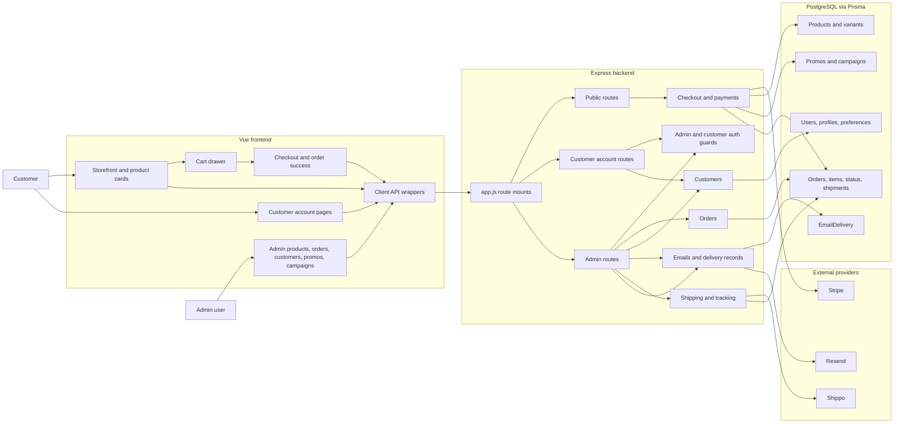
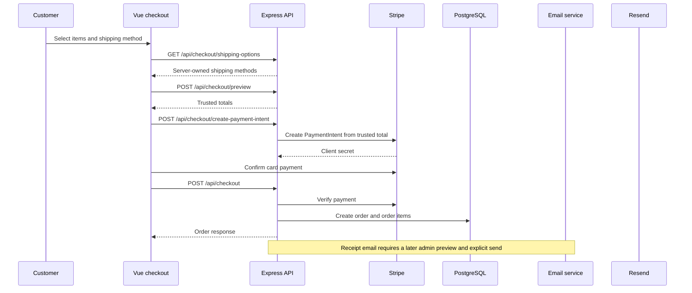
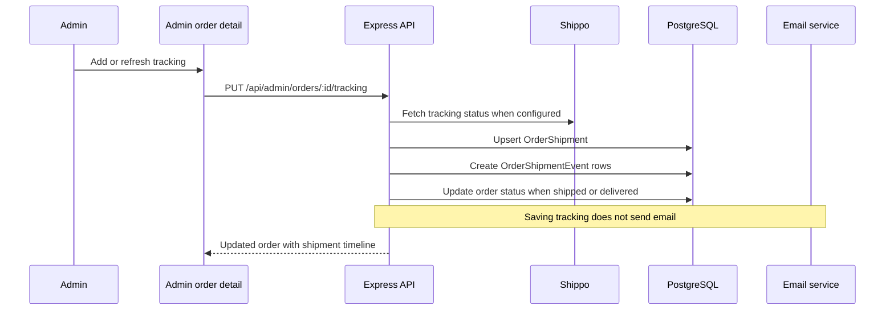
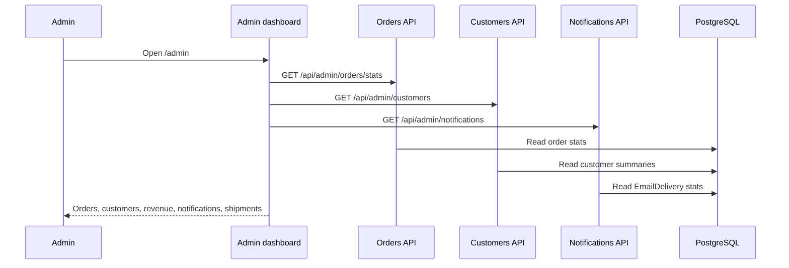

# Doggy Ent Mock Architecture

This supplemental diagram reflects the current commerce app. It is not a mock-data implementation. Order and tracking emails require a separate explicit admin preview/send; they are not checkout or tracking automation.

## Checkout And Notification Sequence

## Admin Tracking Sequence

## Admin Dashboard Sequence

